reag<h1 align="center">내 컴퓨터에 개발자용 '작업실' 꾸미기(2-1)</h1>
<p align="right">( 과제 제출자 : 신 재 풍 )</p>

## 실습 환경 : OS · 터미널 · Docker · Git 
```
Windows Terminal → Ubuntu (WSL2)
본 과제 요구사항을 보면, Windows Terminal → Ubuntu (WSL2)를 선택하는 것이    
리눅스 명령어 사용과 권한 그리고 디렉터리 작업을 실제 리눅스 환경에서 연습할 수 있어서   
과제의 취지에 잘 맞는다고 생각 합니다.
다만 Docker Desktop을 설치하고, WSL2 연동을 설정해야 합니다.     

OS:     Windows 11, Ubuntu on WSL2 (Ubuntu 26.04.1 LTS)    
쉘:     bash --version (경로: /bin/bash)   
        "$SHELL"은 현재 사용자의 기본 셸 경로가 들어 있는 환경 변수입니다.   
        문서의 echo "$SHELL" 명령은 그 값을 출력하며,  
        Ubuntu on WSL에서 Bash를 기본 셸로 사용한다면 보통 (/bin/bash) 처럼 나옵니다.  
터미널:  Windows Terminal  
Docker: Docker Desktop 및 Docker 버전 (Docker version 29.9.2)  
Git:    git version (2.56.0.windows.4)     

Ubuntu는 WSL 위에서 실행되는 리눅스 배포판입니다.
이를 설치하면 Windows 안에서 리눅스 명령어, 개발 도구, 패키지 설치 기능 등을 사용할 수 있습니다.
wsl은 Windows Subsystem for Linux의 약자입니다.
WSL이 리눅스를 실행하는 기반이고, Ubuntu는 실제로 사용자가 작업하는 리눅스 환경입니다.
즉, Ubuntu는 WSL에서 사용하는 실제 리눅스 작업 환경입니다.

- WSL: 리눅스를 실행하게 해주는 기능.
- Ubuntu: 실제로 들어가서 사용하는 리눅스 환경.
- Ubuntu를 통해 리눅스 명령어 사용, 개발 도구 설치, 프로그래밍/빌드/실습 가능.
```

준비 순서는 다음과 같습니다. (Windows 11 기준)
## 1. 가상화 사용 설정  
```
Windows 작업 관리자 → 성능 → CPU에서 “가상화 : 사용” 으로 설정 합니다.   
("사용 안 함" 으로 설정하면, 나중에 BIOS/UEFI에서 가상화를 켜야 할 수 있습니다.)
```

## 2. WSL2와 Ubuntu 설치  
```
본 설치는 “설치 명령 1번”으로 끝나는 것이 아니라,   
(1) 설치 → (2) 재부팅 → (3) Ubuntu 초기설정 
의 과정을 거쳐야 완료됩니다.

Windows 시작 메뉴에서 PowerShell을 "관리자 권한으로 실행함" 으로 설정합니다.  
그리고 PowerShell이 나타나면, 마우스 오른쪽 버튼으로 선택하여,   
“이 앱이 디바이스를 변경하도록 허용할까요?” 라는 질문에 "예"를 눌러 허용을 합니다.  
```

이렇게 관리자 권한을 거쳐서,   
Windows 창의 프롬프트가 PS C:\Users\User>로 나타나면 다음과 같이 설치 명령어를 실행합니다.
## (2-1) 설치 명령어 : wsl --install -d Ubuntu  
```
PS C:\Users\User> wsl --install -d Ubuntu
```
## (2-2) 재부팅
이렇게 설치가 끝나면, 시스템 환경을 새로운 환경에 맞추기 위해 재부팅을 실행 하여야 합니다. 

## (2-3) Ubuntu 초기설정
그리고 재부탕을 한 다음, Windows 시작 메뉴에서 "Ubuntu"를 입력하여     
Ubuntu의 초기설정을 진행 하도록 합니다.
```
⏺️Ubuntu 창에서, Linux 사용자 이름과 비밀번호를 설정합니다. 
( 주의 사항 : 비밀번호를 Ubuntu 창에서 입력할 때,   
화면에 글자가 표시되지 않으므로 오타없이 잘 입력해야 합니다. )

⏺️Ubuntu 시스템 보고서를 Ubuntu 개발사인 Canonical과 공유하시겠습니까?   
공유하지 않으려면 n을 입력하고 Enter를 누릅니다.   
( 이러한 선택은 Windows에 저장되어 다시 묻지 않습니다. Ubuntu 사용에 영향을 주지 않습니다. )
⏺️"플랫폼 사용 지표 수집에 동의하시겠습니까? 수집되는 데이터의 예시를 보려면 e를 입력하세요.[Y/n/e]:?" 에서 n 을 선택합니다.
```
이와같이 초기설정이 끝나고 설치가 완료되면, Ubuntu를 사용할 준비가 된 것입니다.

그 다음으로 해야 할 일은,   
점검하는 차원에서 "설치 확인 명령어"를 사용할 수 있고,   
또는 아래와 같은 원인들로 인하여 실제 사용이 않될 경우도 있기 때문에,   
다음과 같은 "설치 확인 명령어"를 사용하여 사전에 점검하면 좋습니다.
## (2-4) 설치 확인 명령어 : wsl --list --verbose
PS C:\Users\User> wsl --list --verbose  

```
wsl --list --verbose 명령어는  
설치된 WSL 배포판을 이름, 실행 상태, WSL 버전과 함께 자세하게 표시합니다.

"Linux용 Windows 하위 시스템에 설치된 배포가 없습니다.  
아래 지침에 따라 배포를 설치하여 해결할 수 있습니다." 라는 뮨구가 나오면,   
Ubuntu를 다시 설치해야 합니다.
```

#### ⏺️초기설치는 했으나, 에러가 발생하는 경우
```
1) 목록에는 Ubuntu가 보이는데 실제 실행하면 오류가 나는 경우 :
설치는 됐지만 실행 과정에서 문제가 생길 수 있습니다.

2) WSL2 실행 조건이 제대로 준비되지 않은 경우 :
설치 절차를 따라 했더라도 시스템 설정 상태에 따라 문제가 생길 수 있습니다.

3) 재부팅 후 구성 적용이 완전히 안 된 경우 :
재부팅은 했지만 어떤 구성 요소가 정상 반영되지 않아서 문제가 생길 수 있습니다.

4) Ubuntu 초기 설정 중 문제가 생긴 경우 :
사용자 이름/비밀번호를 만드는 과정에서 정상적으로 마무리 되지 않아서 문제가 생길 수 있습니다.

5) 회사나 학교 PC 같은 제한된 환경인 경우 :
관리자 권한 제한, 보안 정책, 조직 설정 때문에 문제가 생길 수 있습니다.
```

## (2-5) Ubuntu 설치 완료
설치가 성공하면,   
user 이름과 호스트 이름:/mnt/c/Users/User$ 라는 프롬프트가 나타납니다.  
여기서 "/mnt/c/Users/User"는 Linux의 경로명 표기방식입니다.   
즉, 맨 앞의 /가 Linux 파일 시스템의 뿌리 디렉터리부터 시작한다는 뜻입니다.  
여기에서는 Linux의 프롬프트를 ...$로 표기 하겠습니다.

...$는 Ubuntu 명령을 입력할 수 있다는 표시이고,
Ubuntu가 정상적으로 시작하게 되었다는 것입니다.   


명령어  
# 3.Ubuntu 업데이트  
명령어 sude apt update는 Ubuntu의 패키지 목록을 최신 상태로 갱신합니다.  

-sudo: 관리자 권한으로 실행. ("super user do”의 줄임말)
-apt: Advanced Package Tool의 약자로 Ubuntu의 패키지 관리 도구.   
-update: 저장소에서 최신 패키지 정보를 가져와 목록을 갱신.   

이 명령은 프로그램 자체를 업그레이드하지는 않습니다.     
## 실제 패키지 업그레이드는 sudo apt upgrade로 합니다.   
```
주의사항 :   
업데이트 종류에 따라 재부팅이 필요하거나 기존 환경에 영향을 줄 수 있으니,   
중요한 작업 중에는 피하고 서버에서는 백업과 점검 후 적용하는 것이 좋습니다.
```
     
## (3-1) 업데이터 하는 명령어 : sudo apt update   
터미널에서 Ubuntu의 영역 안으로 이동하여, 명령어를 실행 합니다.   
PS C:\Users\User> wsl -d Ubuntu  
usershinmodel_15879@4F-74:/mnt/c/Users/User$   
usershinmodel_15879@4F-74:/mnt/c/Users/User$ sudo apt update  

```
그러면 [sudo: authenticate] Password:   
이와같이 비밀번호를 묻습니다. 
이미 설정한 "Linux 비밀번호"를 똑같이 입력합니다.

sudo apt update를 먼저 실행한 것은 업데이트 가능한 패키지가 있는지 확인하고  
목록을 갱신하기 위해서입니다.  
이 명령은 설치된 프로그램을 바꾸지 않으며,   
실행 결과로 “133개 패키지를 업그레이드할 수 있다”는 정보를 보여주면서  
## "업데이터가 완료되었음"을 간접적으로 표현하고 있습니다.

133 packages can be upgraded. Run 'apt list --upgradable' to see them.
usershinmodel_15879@4F-74:/mnt/c/Users/User$ 
```

## (3-2) 업데이터를 확인하는 명령어 : lsb_release -a 
usershinmodel_15879@4F-74:/mnt/c/Users/User$ lsb_release -a 
```
현재 버전은 Ubuntu 26.04.1 LTS를 사용 중입니다.
```
# 4. Docker 설치   

```
여기서 Docker Desktop이라는 것은 제품의 정식 명칭이지,  
데스크톱 컴퓨터 전용이라는 뜻은 아닙니다. 하하! 노트북에서도 사용할 수 있습니다.

Windows에서는 Docker를 실행하는 방법이 몇 가지 있는데,   
Docker Desktop은  
Windows 앱이 WSL의 Ubuntu와 연동해 Docker를 쉽게 사용하도록 해주는 방식입니다.   
(Ubuntu 안에 Docker Engine을 직접 설치하는 방법도 있지만 설정이 더 필요하므로,)   
WSL을 처음 준비하는 경우에는 다음과 같은 Docker Desktop 설치 방식을 권합니다.
```

## (4-1) Docker 설치 명령어: winget install -e --id Docker.DockerDesktop
PowerShell로 이동하여 다음 명령어를 실행 합니다.   
...$ exit   
logout   
PS C:\Users\User>   

PS C:\Users\User> winget install -e --id Docker.DockerDesktop   

```
이렇게 Windows에서 "Docker Desktop"을 설치하고,   
설정에 들어가서 "WSL2 엔진"과 "Ubuntu 연동"을 켜놓는 단계를 거쳐야 합니다. 
( Docker Desktop이 실행 중으로 설정 되어야만, Ubuntu에서 Docker 명령을 사용할 수 있개 됩니다.)
```

Do you agree to all the source agreements terms?
[Y] Yes  [N] No: y를 선택합니다.   
Successfully installed   
PS C:\ Users\User>    

여기서는 "Docker 설치가 성공 되었다"는 메시지가 나왔지만,   
엄밀히 말하면 "Docker 설치 완료"이지,   
사실은 점검을 해보아야 성공임을 비로서 알 수 있는 것입니다.    
## 그러므로 여기서는, "Docker 설치완료" 라는 표현을 사용하겠습니다.  

## (4-2) Docker 설치 확인 명령어 :   
이 명령어는 Docker가 사용 가능한지와 Docker 클라이언트의 버전을 확인해 줍니다.   
Windows powershell에서, 다음과 같이 명령어를 실행합니다.   
#### 1️⃣docker --version    
```
PS D:\sjp\My_Developer_Workspace> docker --version  
Docker version 29.9.2, build a82e528  
```

다음으로 명령어 docker version은,     
Docker 클라이언트와 Docker 엔진(Server)의 버전 및 연결상태를 확인해 줍니다.  
-Client: 현재 터미널에서 실행하는 Docker 명령 도구의 정보.    
-Server: 컨테이너를 실제로 관리하고 실행하는 Docker 엔진의 정보.    
-이외에도 API 버전, 운영체제, architecture 등의 정보가 표시됩니다.  

⭕Client와 Server 정보가 모두 나오면 Docker 엔진에 연결된 상태입니다.  

🚫그러나, Client 정보만 나오고 연결 오류가 발생하면 Docker 명령 도구는 있지만      
엔진에 연결하지 못한 것입니다.  
이때는 Docker Desktop이 실행 중인지, WSL2의 Ubuntu 연동이 켜져 있는지 확인해야    
합니다. 
Windows powershell에서, 다음과 같이 명령어를 실행합니다.
#### 2️⃣docker version  
```
PS D:\sjp\My_Developer_Workspace> docker version 

Client:  
 Version:           29.9.2  
 API version:       1.56  
 Go version:        go1.26.10  
 Git commit:        a82e528  
 Built:             Tue Oct 20 19:44:07 2026  
 OS/Arch:           windows/amd64  
 Context:           desktop-linux  
🚫failed to connect to the docker API at npipe:////./pipe/dockerDesktopLinuxEngine;  
check if the path is correct and if the daemon is running:   
open //./pipe/dockerDesktopLinuxEngine: The system cannot find the file specified.  

🚫Docker API에 연결하지 못했습니다.
경로가 올바른지, 데몬(Docker 엔진 서비스)이 실행 중인지 확인하세요.
//./pipe/dockerDesktopLinuxEngine을 열 수 없습니다. 
시스템이 지정된 파일을 찾을 수 없습니다.
```
#### 1차 실행 실패 :  
다음 순서대로 다시 확인을 해야 합니다.  
Windows 시작 메뉴에서,     
1️⃣Docker Desktop을 실행하여, 엔진이 시작될 때까지 기다립니다.   

(왼쪽 아래에 "Docker Desktop is running" 또는 "Engine running"있어야 하는 데,)  
그렇지 않으면 다음 순서대로 설정을 확인 해야 합니다.   

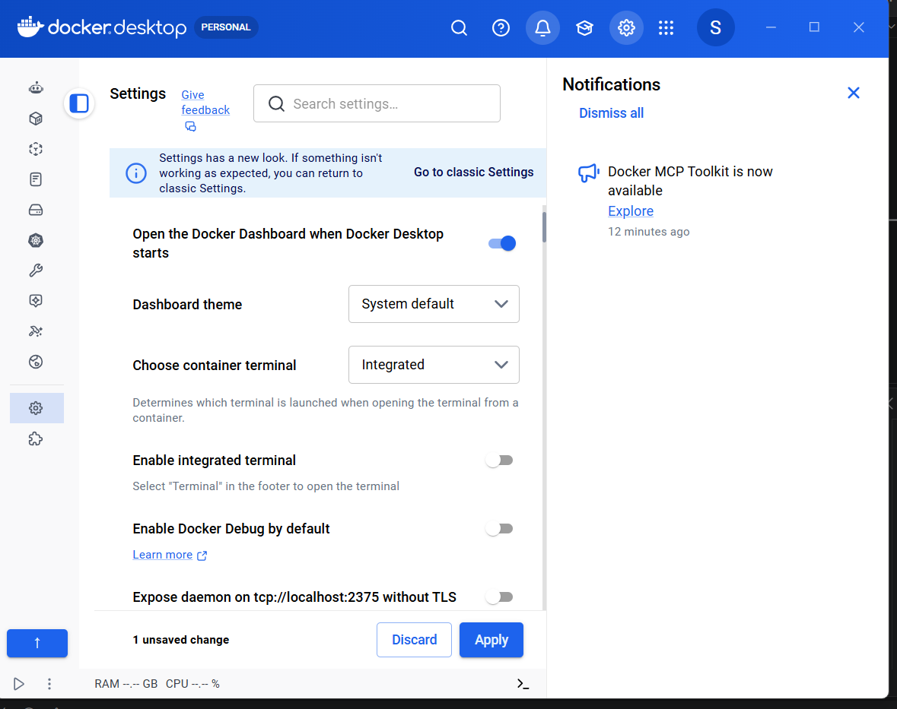

2️⃣Docker Desktop의 Settings에서:   
General → Use "the WSL2" based engine이 켜져 있는지 확인 합니다.
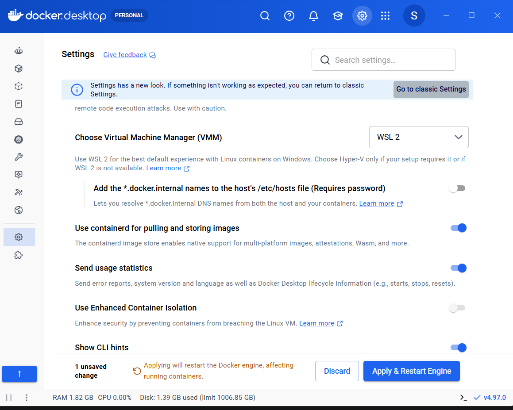

3️⃣Docker Desktop → Settings → Resources →" WSL Integration"에서
"Ubuntu" 연동을 켜고   
"Apply & restart"를 선택하고 나옵니다.

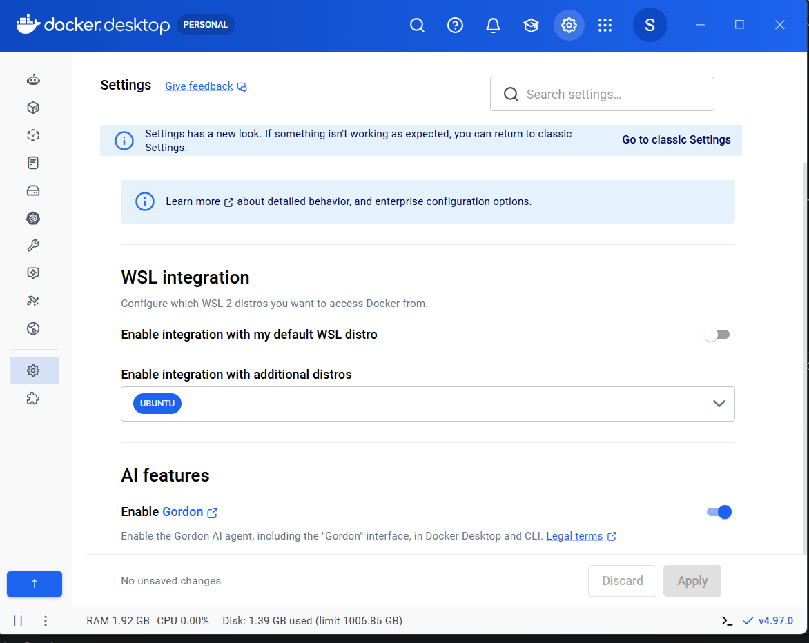

4️⃣Windows Terminal(새 탭 메뉴)에서,  
"Ubuntu"탭을 새로 열고, 다음과 같이 명령어를 실행합니다.  
## docker version
## docker run --rm hello-world  

```
docker run --rm hello-world는 "Docker 정상 작동 확인"을 하는 명령어입니다.  
⏺️docker run : 지정한 이미지로 컨테이너를 만들어 실행합니다.  
⏺️--rm:        컨테이너가 실행을 마치면 컨테이너를 자동으로 삭제합니다.   
                (내려받은 hello-world 이미지는 삭제하지 않습니다.)  
⏺️hello-world: 실행할 이미지 이름입니다.  
                (로컬에 이미지가 없으면 Docker Hub에서 내려받습니다.)  

정상 실행되면 ⭕Hello from Docker! 메시지가 출력됩니다.  
이는 Docker client가 Docker engine에 연결해 컨테이너를 실행했다는 뜻입니다.  
```

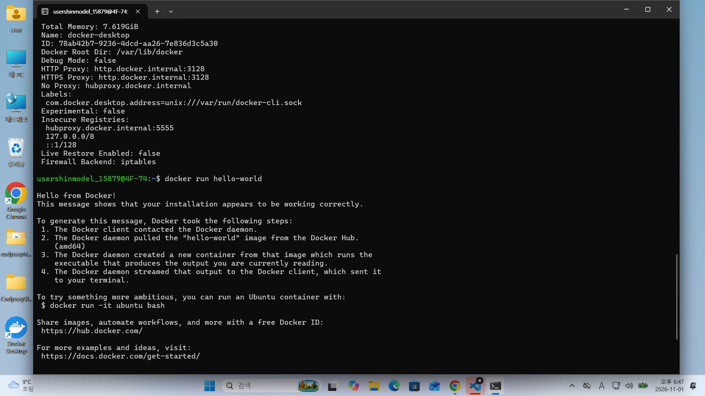
```
⭕Hello from Docker!  
This message shows that your installation appears to be working correctly.  

To generate this message, Docker took the following steps:  
 1. The Docker client contacted the Docker daemon.  
 2. The Docker daemon pulled the "hello-world" image from the Docker Hub.  
    (amd64)  
 3. The Docker daemon created a new container from that image which runs the  
    executable that produces the output you are currently reading.  
 4. The Docker daemon streamed that output to the Docker client, which sent it  
    to your terminal.  

To try something more ambitious, you can run an Ubuntu container with:  
 $ docker run -it ubuntu bash  

Share images, automate workflows, and more with a free Docker ID:   
 https://hub.docker.com/   

For more examples and ideas, visit:  
 https://docs.docker.com/get-started/   
```

## (4-3) 최종 설치 성공 :  
```
⭕Hello from Docker! 메시지가 나오면 Docker 설치완료와 실행준비가 되었다는 것입니다.       
즉, Ubuntu에서 Docker 엔진 연결과 컨테이너 실행까지 "최종 설치 성공"을 확인한 것입니다.  

⏺️--rm 옵션을 사용하면, 삭제 기능으로 컨테이너에서 실행 후 화면 정리를 깨끗하게   해줍니다. 그리고 docker stop dashboard 실행 시에는 컨테이너 자체도 삭제됩니다. 
```

Client와 Server 정보가 모두 나오고 docker run이 정상 실행되면,   
## (4-4) ~/workstation$으로 이동하여, 다음 명령어들을 실행합니다. 
```
cd ~/workstation

~/workstation$
docker run --rm -d --name dashboard \
  -p 8080:80 \
  -v "$PWD/app:/usr/share/nginx/html" \
     nginx:latest

이 명령은 현재 폴더의 app 디렉터리를 웹 문서로 제공하는 Nginx 컨테이너를   백그라운드에서 실행합니다.
🟩docker run: 이미지로 컨테이너를 만들어 실행합니다.
🟩--rm: 컨테이너가 중지되면 컨테이너를 자동 삭제합니다. 이미지는 삭제하지 않습니다.
🟩-d: 터미널을 점유하지 않고 백그라운드에서 실행합니다.
🟩--name dashboard: 컨테이너 이름을 dashboard로 지정합니다.
🟩-p 8080:80: 컴퓨터의 포트 8080을 컨테이너의 포트 80에 연결합니다.
🟩-v "$PWD/app:/usr/share/nginx/html": 현재 위치의 app 폴더를 컨테이너의 Nginx 웹 문서 폴더에 연결합니다.
🟩nginx:latest: 실행할 Nginx 이미지입니다. 이미지가 로컬에 없으면 Docker가 내려받습니다.
🟩줄 끝의 \: Bash에서 명령이 다음 줄에도 이어진다는 표시입니다.
```
docker ps로 dashboard가 Up 상태이고 포트가 8080:80으로 연결됐는지 확인합니다.
## (4-5) docker ps 명령어를 실행합니다.  
```
~/workstation$ docker ps  

CONTAINER ID   IMAGE          COMMAND                  CREATED         STATUS         PORTS                                     NAMES   
c5cf9bf77ea1   nginx:latest   "/docker-entrypoint.…"   3 minutes ago   Up 3 minutes   0.0.0.0:8080->80/tcp, [::]:8080->80/tcp   dashboard   

정상입니다.  
dashboard 컨테이너가 실행 중이고, 포트 8080이 연결되었습니다.  
```
## (4-6) 드디어 Docker 컨테이너 "dashboard" 연결  
브라우저에서 http://localhost:8080 을 엽니다.  
그러면 Docker 컨테이너 "dashboard"가 나타납니다.  
```
참고 사항 :
⏺️확인이 필요하면 Ubuntu 터미널에서 다음을 실행할 수 있습니다.   
curl -I http://localhost:8080   
HTTP/1.1 200 OK가 나오면 정상입니다.   

⏺️주소창 오른쪽 자물쇠나 자동 HTTPS 설정 때문에 HTTPS로 바뀐다면:   
" s "를 지우고 http://127.0.0.1:8080 입력하면 됩니다.   
```
## (4-7) 대시보드로 들어가는 명령어 : explorer.exe http://localhost:8080   
당연히 컨테이너가 실행 중일 때 가능합니다.  
index.html 파일은 app/index.html의 파일이 대시보드의 원본 입니다.
```
~/workstation$ explorer.exe http://localhost:8080
```

(1-1) 나의 개발 작업실
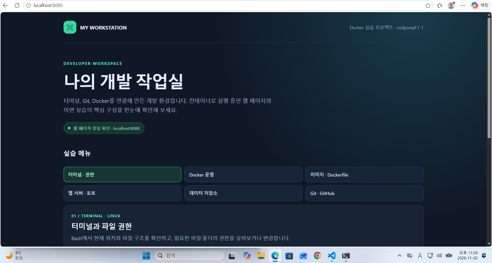
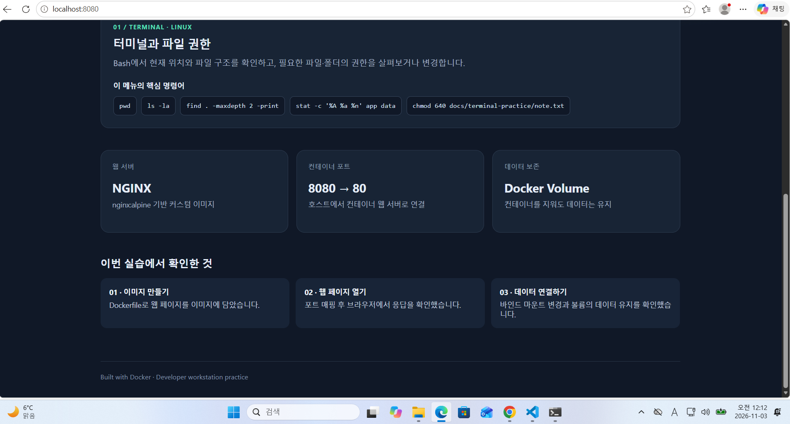

(1-2) 터미널과 파일 권한
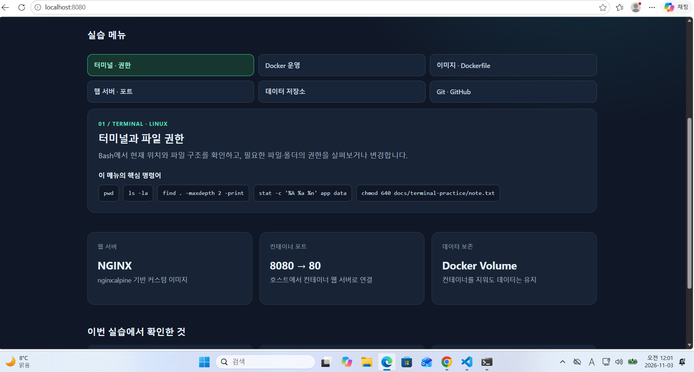

(2) Docker 엔진과 컨테이너 운영
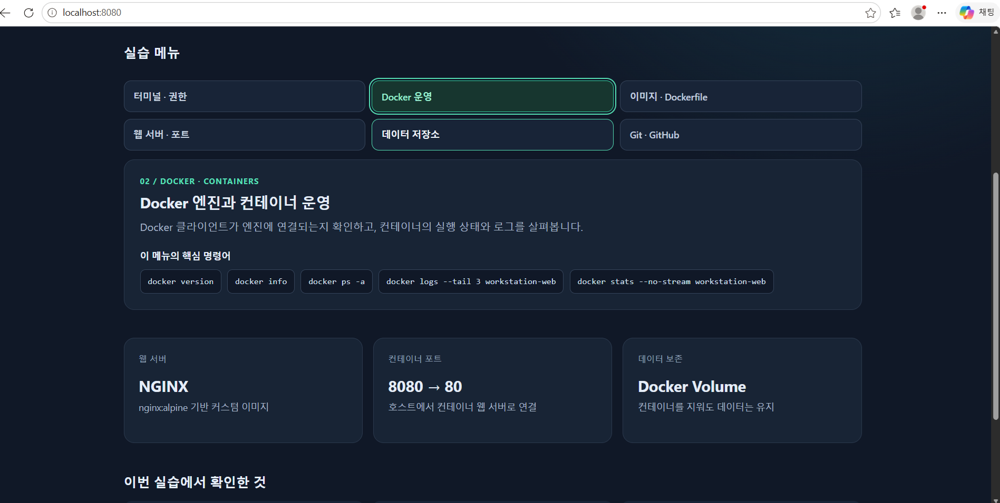

(3) Dockerfile로 이미지 만들기
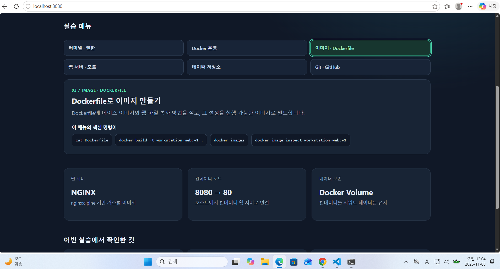

(4) 웹 서버와 포트 연결
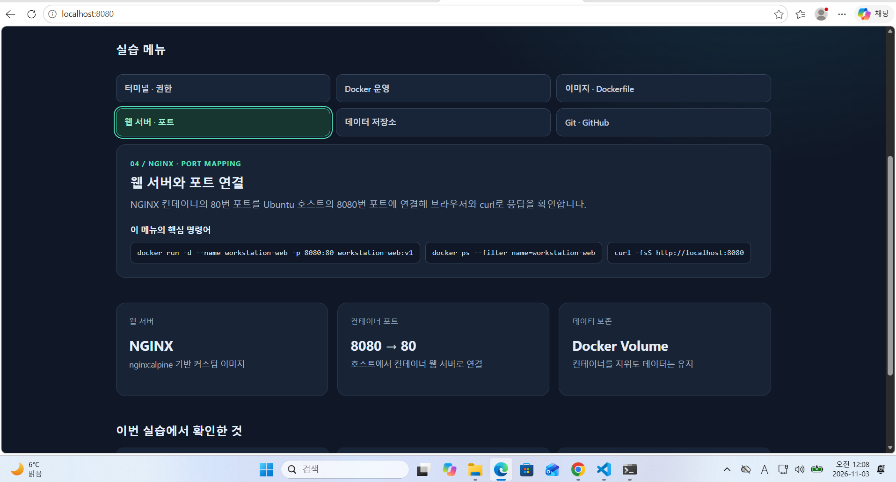

(5) 바인드 마운트와 볼륨
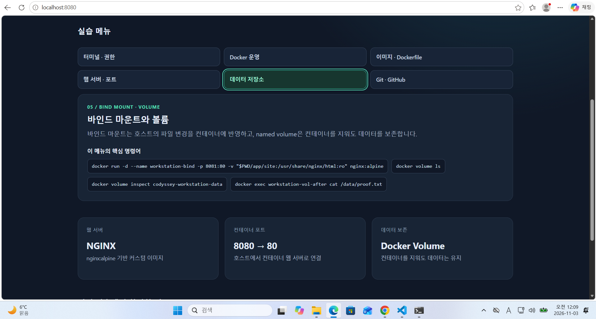

(6) Git과 GitHub 저장소
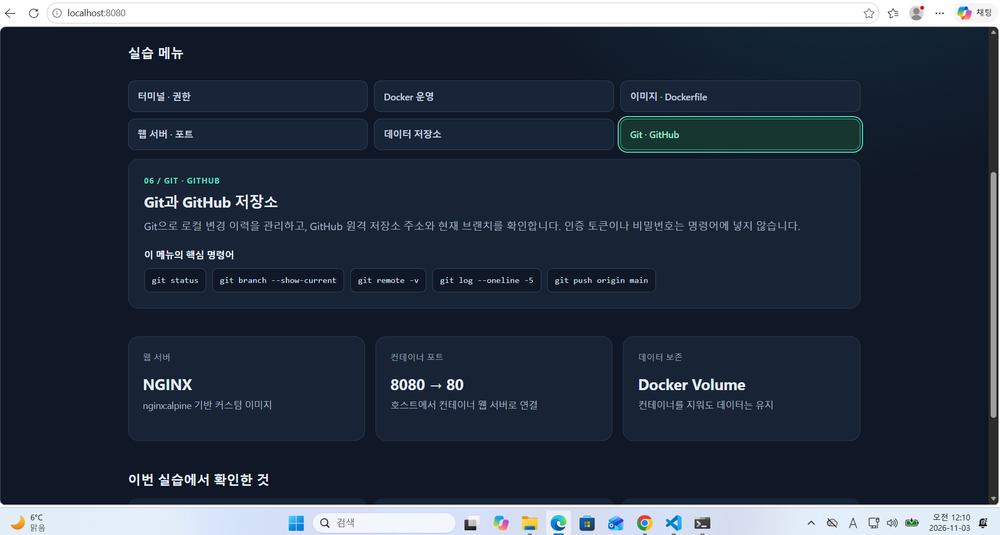

## 5. 프로젝트 폴더와 Dockerfile 준비 

대시보드 작업장의 README는 Ubuntu에서 위치 경로명은 ~/workstation/README.md 입니다.   
폴더 안에는 README.md와 함께 Dockerfile, images, app, data, rmflrh docs 안의 파일들이 더 있습니다.

#### git --version  
```
git의 버전이 표시되면 git이 설치되어 있고 사용할 수 있다는 것을 확인할 수 있습니다.  
PS D:\sjp\My_Developer_Workspace> git --version  
git version 2.56.0.windows.4   
```

#### tree 설치 명령어 : sudo apt install tree  
```
Ubuntu 터미널 프롬프트에서, install를 실행합니다.
usershinmodel_15879@4F-74:~/workstation:~$ sudo apt install tree

그리고 비밀번호 : (Ubuntu 사용자 비밀번호)를 똑같이 입력합니다.

usershinmodel_15879@4F-74:~/workstation$ sudo apt install tree
[sudo: authenticate] Password:
sudo: Authentication failed, try again.
[sudo: authenticate] Password:
Installing:
  tree

Summary:
  Upgrading: 0, Installing: 1, Removing: 0, Not Upgrading: 31
  Download size: 53.5 kB
  Space needed: 125 kB / 1024 GB available

Get:1 http://archive.ubuntu.com/ubuntu resolute/universe amd64 tree amd64 2.3.1-1 [53.5 kB]
Fetched 53.5 kB in 1s (38.0 kB/s)  
Selecting previously unselected package tree.  
(Reading database ... 35907 files and directories currently installed.)  
Preparing to unpack .../tree_2.3.1-1_amd64.deb  
Unpacking tree (2.3.1-1)  
Setting up tree (2.3.1-1)  
Processing triggers for man-db (2.13.1-1build1)  
```

## 6. 폴더 구조
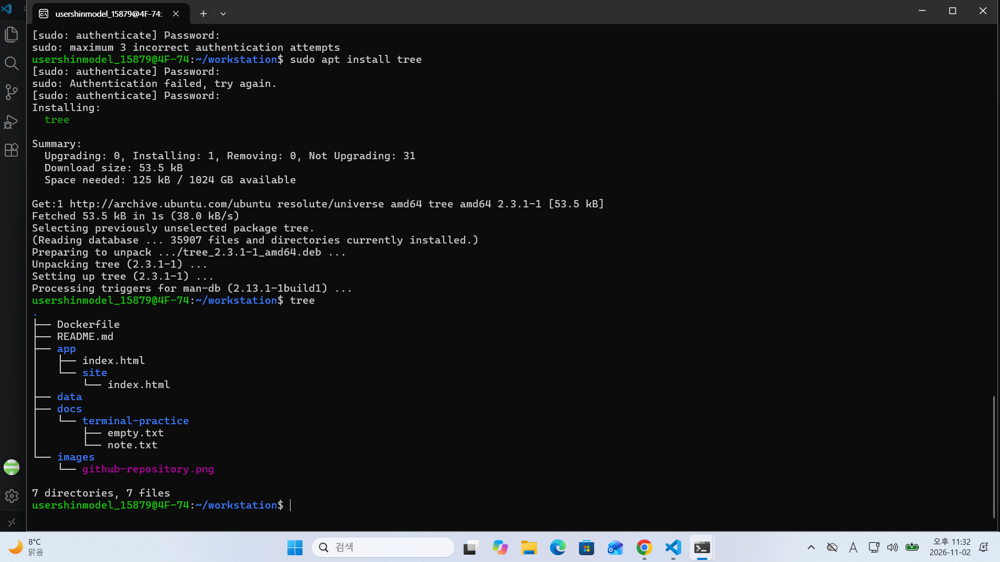

## 7. 철저한 종료 방법 :

⏺️브라우저와 컨테이너를 모두 종료하려면:  docker stop dashboard   
⏺️Docker Desktop을 완전히 종료하려면,  
Windows 작업 표시줄 알림 영역의 Docker 아이콘을 우클릭해서,   
                          Quit Docker Desktop을 선택하면 됩니다.  
⏺️Docker Desktop은 계속 켜져 있을 수 있으며,   
       Ubuntu 재접속 후 다시 시작하려면: docker start dashboard  
⏺️Ubuntu 터미널 종료 : exit  
```
-브라우저 창의 "X"만 누르면 Docker 컨테이너는 종료되지 않습니다.  
☑️대시보드와 컨테이너를 종료하려면   
      Ubuntu 터미널에서 docker stop dashboard 명령을 실행합니다.  
☑️브라우저 탭은 "x"나 "Ctrl + W" 눌러서 닫으면 됩니다.   

-실행 명령에 --rm 옵션이 있으므로 컨테이너는 중지된 뒤 자동 삭제됩니다.  
-따라서 다시 실행할 때는 docker start dashboard가 아니라   
 앞서 사용한 docker run ... 명령을 다시 실행해야 합니다.  

☑️Ubuntu 터미널까지 종료하려면 마지막에 exit을 입력하세요.  

Docker Desktop 앱은 별도로 종료하지 않는 한 계속 실행됩니다.  
Docker Desktop 앱은 켜 둬도 괜찮고, 다음에 Docker를 다시 사용할 때도 편리합니다.  
Docker Desktop은 계속 켜져 있을 수 있으며,   
⭕Ubuntu 재접속 후 다시 시작하려면: docker start dashboard   
☑️Docker Desktop까지 완전히 종료하려는 경우에만   
☑️Windows 작업 표시줄 알림 영역의 Docker 아이콘을 우클릭해 Quit Docker Desktop을 선택하세요.   

지금처럼 로컬 컴퓨터에서 대시보드를 실행하면 별도의 클라우드 요금은 발생하지 않지만,   
Docker Desktop이 켜져 있는 동안 컴퓨터의 메모리와 CPU는 전력을 사용합니다.  
안 쓸 때 앱을 종료하면 자원 사용을 줄일 수 있습니다.   
```
## 8. 과제를 통해서 잘 알게된 사항 :

#### (8-1) 절대 경로와 상대 경로  
파일이나 폴더의 위치를 나타내는 방법에는 절대 경로와 상대 경로가 있습니다.  
절대 경로는 기준이 되는 위치부터 목적지까지 전체 경로를 적는 방법입니다.   
예를 들어, Ubuntu에서 홈 폴더 안의 docker-practice 폴더는  
**/home/user 이름/docker-practice** 처럼 항상 근본부터 나타내야 합니다.  

상대 경로는 현재 내가 있는 위치를 기준으로 목적지를 나타내는 방법입니다.    
내가 현재 작업하는 위치가 **/home/user 이름**라면 그 위치를 기준으로 **docker-practice** 라고 경로를 나타내면 됩니다.  

그래서 같은 파일이라도 현재 위치에 따라 상대 경로가 달라질 수 있습니다.   
절대 경로는 어디에서 사용하든 같은 위치를 가리키지만, 상대 경로는 현재 위치를 알아야 정확히 이해할 수 있습니다.  

#### (8-2) 파일 권한과 숫자표기 755, 644  
Linux에서는 파일이나 폴더에게 누가 어떤 작업을 할 수 있는지 권한으로 정합니다.   
권한 표기에서 r은 읽기, w는 쓰기, x는 실행을 뜻합니다.  

755나 644 같은 숫자는 소유자, 그룹, 그 밖의 사용자 순서로 권한을 나타냅니다.   
각 자리의 숫자는 r=4, w=2, x=1을 더해서 계산합니다.  

예를 들어 755는 **소유자**에게 4+2+1, 즉 읽기(4), 쓰기(2), 실행하기(1) 권한을 주고,   
**그룹**에게 4+1 즉, 읽기(4), 실행하기(1) 권한을 주고,  
**그 밖의 사용자**에게 4+1 즉, 읽기(4), 실행하기(1) 권한을 준다는 뜻입니다.   

644는 **소유자**에게 읽기(4), 쓰기(2) 권한을 주고,   
**그룹**에게 4 즉, 읽기(4) 권한을 주고,  
**그 밖의 사용자**에게 4 즉, 읽기(4) 권한을 준다는 뜻을 숫자로 나타낸 것입니다.  

#### (8-3) 기존 Dockerfile을 활용한 custom images  
Dockerfile은 Docker 이미지를 만들 때 필요한 작업을 적어 둔 파일입니다.   
기존 이미지를 바탕으로 필요한 파일을 추가하거나 설정을 바꾸면 나만의 커스텀 이미지를 만들 수 있습니다.  

예를 들어 nginx:alpine 이미지를 바탕으로 웹페이지 파일을 추가하려면 다음처럼 작성할 수 있습니다.  
**nginx:alpine**은 Docker 이미지 이름으로, Alpine Linux 기반의 Nginx 이미지이며, 이를 바탕으로 웹페이지 파일을 추가해 컨테이너 이미지를 만들 수 있습니다.
FROM은 바탕이 될 이미지를 정하고,   
COPY는 내 컴퓨터의 웹페이지 파일을 이미지 안으로 복사합니다.   
이렇게 Dockerfile로 이미지를 만들면, 기본 Nginx 기능에 내 웹페이지가 포함된 커스텀 이미지를 사용할 수 있습니다.  

#### (8-4) 포트 매핑의 역할    
컨테이너 안에서 실행되는 웹 서버의 포트는 아무 중재없이 그냥 내 컴퓨터에서 서로 연결할 수 없기에, 호스트 컴퓨터의 포트와 컨테이너의 포트를 연결하는 포트 매핑이 필요합니다.  

예를 들어 다음 명령은 내 컴퓨터의 8080 포트를 컨테이너의 80 포트에 연결합니다.  
이렇게 실행하면 브라우저에서 http://localhost:8080으로 접속해 컨테이너 안의 웹 서버를 확인할 수 있습니다.  
여기서 앞의 8080은 내 컴퓨터의 포트이고, 뒤의 80은 컨테이너 안의 포트입니다.  

#### (8-5) Docker volume과 영속 데이터  
Docker의 volume은 소프트웨어적으로 관리되는 저장 공간이며 하드웨어 그 자체는 아니지만, 데이터가 호스트 컴퓨터의 디스크(SSD·HDD 등)에 기록되면 지워지지 않습니다.
컨테이너 안에 저장된 데이터가 컨테이너를 삭제할 때 함께 사라지지 않도록 보관하기 위해서 컨테이너와 별도로 다른 저장 공간을 연결하도록 Docker 볼륨을 사용하고 있습니다.   

#### (8-6) Git과 GitHub의 차이  
Git은 내 컴퓨터에서 파일의 변경 이력을 기록하고 관리하는 버전 관리 도구입니다.   
언제 어떤 내용을 바꿨는지 살펴보고, 필요하면 이전 상태로 돌아갈 수 있습니다.  

GitHub는 Git으로 관리하는 저장소를 인터넷에 보관하고 다른 사람과 공유하거나 협업할 수 있게 해주는  platform 입니다.  

즉, Git은 로컬에서 버전을 관리하는 도구이고, GitHub는 저장소를 원격으로 보관하고 협업하는 공간입니다.  


----------------------------------------------------------------
<h1 align="center">내 컴퓨터에 개발자용 '작업실' 꾸미기(2-2)</h1>
<p align="right">( 과제 제출자 : 신 재 풍 )</p>

## 1. 미션 개요

터미널의 파일과 권한 조작, Docker 이미지와 컨테이너 운영, Dockerfile 기반 웹 서버 실행, 포트 매핑, 바인드 마운트와 볼륨의 차이를 직접 검증한 기록입니다. Git으로 변경을 관리하고 GitHub 저장소에 결과물을 연결하였습니다.

- GitHub 저장소: <https://github.com/sinmodel/codysseyE1-1>
- 웹 서버 소스: [`app/index.html`](./app/index.html)
- Dockerfile: [`Dockerfile`](./Dockerfile)
- GitHub 저장소 화면: [`images/github-repository.png`](./images/github-repository.png)

## 2. 실행 환경

| 항목 | 사용 환경 |
|---|---|
| OS | Windows 11, Ubuntu 26.04.1 LTS (WSL2) |
| 터미널 / 쉘 | Windows Terminal / Bash (`/bin/bash`) |
| Docker | Docker Desktop 4.97.0, Engine 29.9.2 |
| Git | Ubuntu WSL의 Git 2.53.0 |
| 원격 저장소 | `https://github.com/sinmodel/codysseyE1-1.git`, `main` |

```console
$ docker --version
Docker version 29.9.2, build a82e528

$ git --version
git version 2.53.0

$ docker info --format '{{.ServerVersion}}'
29.9.2
```

## 3. 수행 체크리스트

- [✔️] 터미널 위치, 목록, 파일 생성, 내용 확인, 복사, 이동 그리고 이름 변경과 삭제
- [✔️] 파일 및 디렉토리 권한 변경과 확인
- [✔️] Docker 버전 및 데몬 점검, `hello-world` 실행
- [✔️] Ubuntu 컨테이너 명령 실행, `exec`와 중지 그리고 삭제 확인
- [✔️] Docker 버전 및 데몬 점검, `hello-world` 실행
- [✔️] 이미지 그리고 컨테이너 목록, 로그, 리소스 통계 확인
- [✔️] NGINX 기반 커스텀 Dockerfile 이미지 빌드
- [✔️] `8080:80` 포트 매핑 후 `curl` 접속 확인
- [✔️] 바인드 마운트 호스트 파일 변경 반영 확인
- [✔️] 컨테이너 삭제 후 named volume 데이터 유지 확인
- [✔️] Git 설정 및 GitHub 원격 저장소 연결 확인
- [✔️] VS Code GitHub 로그인 화면 증거 추가

## 4. 터미널 조작 및 권한 로그

아래 로그의 홈 경로에 포함된 Linux 사용자명은 개인정보 보호를 위해 `<linux-user>`로 표시하였습니다.

```console
$ pwd    /home/<linux-user>/workstation (현재 위치와 파일 목록 확인)

$ ls -la 
.  ..  .git  Dockerfile  README.md  app  data  docs (현재 위치와 파일 목록 확인)

$ mkdir -p  docs/terminal-practice (디렉터리 생성)
$ printf  'CLI practice note\n' > docs/terminal-practice/note.txt  
           (내용이 있는 파일과 빈 파일 생성)
$ touch  docs/terminal-practice/empty.txt (내용이 있는 파일과 빈 파일 생성)
$ cat  docs/terminal-practice/note.txt CLI practice note (파일 내용 출력)

$ cp  docs/terminal-practice/note.txt docs/terminal-practice/copy.txt  
      (파일 복사 후 이름 변경)
$ mv  docs/terminal-practice/copy.txt docs/terminal-practice/renamed.txt  
      (파일 복사 후 이름 변경)
$ ls  docs/terminal-practice empty.txt  note.txt  renamed.txt (디렉터리 안의 파일 확인)
$ rm  docs/terminal-practice/renamed.txt (파일 삭제 후 실제로 없어졌는지 확인)
$ test  -e docs/terminal-practice/renamed.txt && echo removed 
        removed (renamed.txt가 성공적으로 삭제되었음)
```

`pwd` 결과는 절대 경로이고,  
`docs/terminal-practice/note.txt`는 현재 디렉토리를 기준으로 한 상대 경로 입니다.  
권한 변경 전후 확인과 실험 후 문서 폴더와 파일은 공유할 수 있도록 원래 접근 모드로 복원하였습니다.

```console
$ stat -c '%A %a %n' docs/terminal-practice docs/terminal-practice/note.txt
                    drwxr-xr-x 755 docs/terminal-practice
                    -rw-r--r-- 644 docs/terminal-practice/note.txt   
                    (권한을 문자 형식drwxr-xr-x과 숫자 형식755으로 확인합니다.)  

$ chmod 640 docs/terminal-practice/note.txt  
        (소유자는 읽기·쓰기, 그룹은 읽기만, 그 외 사용자는 접근할 수 없도록 설정합니다)   
$ chmod 700 docs/terminal-practice   
                     (소유자만 디렉터리를 읽고, 파일을 만들거나 접근하도록 설정합니다.   
                      디렉터리에서 x는 내부 항목에 접근할 수 있다는 뜻입니다.) 
$ stat -c '%A %a %n' app data docs/terminal-practice docs/terminal-practice/note.txt
drwxr-xr-x 755 app
drwx------ 700 data
drwx------ 700 docs/terminal-practice
-rw-r----- 640 docs/terminal-practice/note.txt
                     (출력된 app은 755, data는 700 권한이었습니다.  
                      이 두 디렉터리는 확인만 했고, 변경하지 않았습니다.)  

$ chmod 755 docs/terminal-practice
$ chmod 644 docs/terminal-practice/note.txt
                (마지막 두 명령은 연습 디렉터리를 755, 파일을 644로 되돌립니다.   
                즉 디렉터리는 다른 사용자도 읽고 접근할 수 있고, 파일은 소유자만 수정할 수 있습니다.)
```

`r/w/x`는 읽기/쓰기/실행 권한입니다.  
숫자 모드는 소유자, 그룹, 기타 사용자 순서입니다.  
따라서 `755`는 `rwx-rx-rx`, `640`은 `rw-r--`를 뜻합니다.  
`data`는 소유자만 접근할 수 있도록 `700`으로 합니다.

## 5. Docker 설치 및 기본 운영 로그

```console
$ docker version (Docker 클라이언트와 서버(엔진)의 버전 및 실행 환경을 보여줍니다.)
Client: Docker 29.9.2, OS/Arch linux/amd64, Context default
Server: Docker Desktop 4.97.0
Engine: 29.9.2, OS/Arch linux/amd64

$ docker run --rm hello-world (컨테이너를 실행해 설치 상태를 확인합니다.   
                --rm은 컨테이너가 종료되면 컨테이너를 자동으로 삭제한다는 뜻입니다.)
Hello from Docker!
This message shows that your installation appears to be working correctly.

$ docker run --rm 
(Ubuntu 24.04 이미지로 컨테이너를 실행하고, 그 안에서 명령을 수행합니다.)  
                   pwd: 현재 위치(/) 출력  
                   ls / | head -n 5: 루트 디렉터리의 항목 중 앞의 5개 출력   
                   echo ubuntu-container-ok: 확인용 문구 출력

ubuntu:24.04 bash -lc 'pwd; 
ls / | head -n 5; 
echo ubuntu-container-ok'
/
bin
boot
dev
etc
home
ubuntu-container-ok
```

실행 중인 컨테이너에 `exec`로 명령을 실행하고 정리하였습다.

```console
$ docker run -d --name workstation-ubuntu-lab ubuntu:24.04 sleep infinity
(Ubuntu 24.04 컨테이너를 백그라운드 -d 에서 실행합니다.    
sleep infinity는 컨테이너가 바로 종료되지 않고 계속 실행되도록 합니다.)   
$ docker exec workstation-ubuntu-lab bash -lc 'echo exec-into-running-container'
exec-into-running-container
(실행 중인 컨테이너 안에서 echo 명령을 실행해 문구를 출력합니다.)
$ docker stop workstation-ubuntu-lab 
workstation-ubuntu-lab (컨테이너를 중지합니다.)
$ docker rm workstation-ubuntu-lab
workstation-ubuntu-lab (중지된 컨테이너를 삭제합니다. Ubuntu 이미지는 삭제하지 않습니다.)
```

`docker run`은 컨테이너를 새로 만들고 시작합니다.  
위의 일회성 `--rm` 실행은 명령이 끝나면 컨테이너를 제거합니다.  
`-d`는 백그라운드에서 계속 실행하고, `exec`는 그 실행 중인 컨테이너에 추가 명령을 실행합니다.  
`stop`은 중지하고 `rm`은 컨테이너를 삭제합니다.

```console
$ docker images
hello-world:latest
nginx:latest
nginx:alpine
ubuntu:24.04
workstation-web:v1

$ docker ps -a
workstation-web   workstation-web:v1   Up   0.0.0.0:8080->80/tcp
ecstatic_haibt    hello-world          Exited (0)
trusting_davinci  hello-world          Exited (0)

$ docker logs --tail 3 workstation-web
... "GET / HTTP/1.1" 200 ...

$ docker stats --no-stream workstation-web
CONTAINER            CPU %   MEM USAGE
workstation-web      0.00%   약 14.48MiB
```

## 6. Dockerfile 기반 웹 서버 및 포트 매핑

기존 베이스 이미지 `nginx:alpine`를 사용하였습니다.  
Dockerfile은 `app/index.html`을 NGINX 기본 웹 루트로 복사해서   
기본 환영 페이지 대신에 과제용 정적 페이지를 제공하는 것으로 하였습니다.

```dockerfile
FROM nginx:alpine

LABEL org.opencontainers.image.title="workstation-web"
LABEL org.opencontainers.image.description="Static site for the developer workstation assignment"

COPY app/index.html /usr/share/nginx/html/index.html
```

```console
$ docker build -t workstation-web:v1 .
#8 naming to docker.io/library/workstation-web:v1 done

$ docker run -d --name workstation-web -p 8080:80 workstation-web:v1
$ docker ps --filter name=workstation-web
workstation-web   Up   0.0.0.0:8080->80/tcp

$ curl -fsS http://localhost:8080
<title>개발자 작업실 대시보드</title>
<div class="brand">MY WORKSTATION</div>
<h1>나의 개발 작업실</h1>
... Docker 환경 요약 및 실습 확인 항목 대시보드 ...
```

컨테이너의 80번 포트를 호스트의 8080번 포트에 연결하였습니다.  
접속 검증은 브라우저와 `curl`로 하였습니다.  
대시보드에는 터미널과 권한, Docker 운영, 이미지와 Dockerfile, 웹 서버와 포트, 데이터 저장소, Git·GitHub의 여섯 메뉴가 있으며, 메뉴를 선택하면 해당 주제의 핵심 요약과 명령어 표식을 보여줍니다.  
웹페이지는 실습 정보를 표시하는 정적 대시보드이며, Docker 상태를 실시간 조회하는 모니터링 도구는 아닙니다.
```
curl은 Client URL의 약자이며, URL을 이용해 서버와 데이터를 주고받는 명령줄 도구이지만,  
보통은 URL 전송 도구의 이름으로 쓰입니다.  
예: curl https://example.com — 해당 주소의 응답을 가져옵니다.  
```
### 대시보드 학습 메뉴와 종료 순서

대시보드의 메뉴는 터미널에서 실행할 명령어를 순서대로 잊지 않도록 돕는 것입니다.  
메뉴는 자동 실행하지 않으며, 사용자가 Ubuntu 터미널에 명령을 입력합니다.

| 메뉴 | 시작 | 확인 | 종료 / 정리 |
|---|---|---|---|
| 터미널 · 권한 | `cd ~/workstation && pwd` | `ls -la && stat -c '%A %a %n' app data` | 실험 권한을 `755(app)`, `700(data)`로 복원 |
| Docker 운영 | Docker Desktop 실행 후 `docker info` | `docker ps -a && docker images` | 실습 컨테이너 `docker stop`, `docker rm` |
| 이미지 · Dockerfile | `cat Dockerfile` | `docker build -t workstation-web:v1 . && docker images` | 남는 연습 이미지 사용 여부 확인 후 선택적으로 삭제 |
| 웹 서버 · 포트 | `docker run -d --name workstation-web -p 8080:80 workstation-web:v1` | `docker ps && curl -fsS http://localhost:8080` | `docker stop workstation-web && docker rm workstation-web` |
| 데이터 저장소 | `docker volume create codyssey-workstation-data` | 볼륨에 연결한 컨테이너에서 파일 내용 확인 | 컨테이너 삭제 후 `docker volume ls`; 필요 없으면 `docker volume rm` |
| Git · GitHub | `git status && git branch --show-current` | `git diff --cached --check && git log -5` | `git push origin main && git status` 확인 |

실습을 종료할 때는 웹 컨테이너와 연습 컨테이너를 먼저 삭제합니다.  
그 뒤 `docker ps -a`로 남은 컨테이너가 없는지 확인하고,  
named volume은 제출에 필요한 데이터가 아니면 별도로 삭제합니다.   

## 7. 바인드 마운트 변경 반영

호스트의 `app/site` 디렉토리를 컨테이너 웹 루트에 읽기 전용으로 연결하였습니다.  
호스트 파일 자체를 수정한 뒤에, 같은 URL의 응답이 바뀌는 것을 확인하였습니다.

```console
$ docker run -d --name workstation-bind -p 8081:80 \
  -v "$PWD/app/site:/usr/share/nginx/html:ro" nginx:alpine
  (컨테이너를 백그라운드에서 실행합니다.)
  컨테이너에 이름을 붙입니다
  호스트의 8081 포트를 컨테이너의 80 포트에 연결합니다.
  호스트의 app/site 디렉터리를 컨테이너의 웹 루트에 연결합니다.  
  :ro는 컨테이너에서 해당 파일을 읽기만 할 수 있다는 뜻입니다.

$ curl -fsS http://localhost:8081
<h1>Bind mount: before host edit</h1>

$ printf '<h1>Bind mount: after host edit</h1>\n' > app/site/index.html
$ curl -fsS http://localhost:8081
<h1>Bind mount: after host edit</h1>
  첫 번째 curl은 기존 HTML을 보여줍니다.  
  호스트에서 index.html을 수정한 뒤 다시 요청하면 새 내용이 출력됩니다.  
  즉, 파일을 이미지에 다시 넣거나 컨테이너를 재생성하지 않아도  
  호스트의 변경 사항이 바로 반영됩니다.

$ docker stop workstation-bind
$ docker rm workstation-bind
  마지막 두 명령은 컨테이너를 중지하고 삭제합니다.  
  마운트된 호스트 파일은 삭제되지 않습니다.
```

## 8. Docker named volume 영속성

테스트 컨테이너에서 named volume에 파일을 쓴 뒤 해당 컨테이너를 삭제하였습니다.  
새 컨테이너에 같은 볼륨을 연결해 파일 내용을 다시 읽었습니다.

```console
$ docker volume create codyssey-workstation-data
codyssey-workstation-data
  docker volume create ...로 이름이 지정된 볼륨을 만듭니다.

$ docker run -d --name workstation-vol-before \  
  -v codyssey-workstation-data:/data alpine sleep infinity  
$ docker exec workstation-vol-before sh -c \  
  'printf "volume-data-survives-container\n" > /data/proof.txt; cat /data/proof.txt'  
volume-data-survives-container  
  첫 번째 Alpine 컨테이너에서 볼륨을 /data에 연결하고,   
  /data/proof.txt에 문자열을 저장합니다.  

$ docker rm -f workstation-vol-before
workstation-vol-before
  첫 번째 컨테이너를 강제 삭제합니다. 볼륨은 따로 삭제하지 않았으므로 데이터가 남습니다.

$ docker run -d --name workstation-vol-after \
  -v codyssey-workstation-data:/data alpine sleep infinity
$ docker exec workstation-vol-after cat /data/proof.txt
volume-data-survives-container  
  같은 볼륨을 두 번째 컨테이너에 다시 연결해 파일을 읽습니다.  
  앞서 저장한 내용이 그대로 출력됩니다.

$ docker rm -f workstation-vol-after
workstation-vol-after  
  두 번째 컨테이너도 삭제합니다.
```

컨테이너를 삭제해도 named volume은 별도로 남아 있어서, 새 컨테이너에서 같은 데이터를 읽을 수 있습니다.  
확인용 볼륨은 삭제하지 않고 유지 중입니다.

## 9. Git / GitHub 설정

```console
$ git config --global init.defaultBranch main  
  git init으로 새 저장소를 만들 때 기본 브랜치 이름을 main으로 설정합니다.  
  현재 저장소의 브랜치를 바꾸는 명령은 아닙니다.  

$ git branch --show-current
main  
  현재 저장소에서 작업 중인 브랜치가 main이라는 뜻입니다.  

$ git config --list (Git 설정을 출력합니다.)
core.repositoryformatversion=0
core.filemode=true
init.defaultBranch=main
user.name=[REDACTED]
user.email=[REDACTED] (커밋 작성자 정보이며)
remote.origin.url=https://github.com/sinmodel/codysseyE1-1.git (원격 저장소 주소입니다.)
remote.origin.fetch=+refs/heads/*:refs/remotes/origin/* 
branch.main.remote=origin
branch.main.merge=refs/heads/main 
(로컬 main 브랜치가 원격 origin의 main 브랜치를 추적하도록 설정되어 있습니다.)

$ git remote -v
origin  https://github.com/sinmodel/codysseyE1-1.git (fetch)
origin  https://github.com/sinmodel/codysseyE1-1.git (push)
```
즉, 현재 main 브랜치가 origin의 main과 연결된 상태이며, 새 저장소의 기본 브랜치도 main으로 지정한 것입니다.

사용자 이름과 이메일은 `git config --list` 요구에 맞춰 기록 하고, 공개 문서에서는 대체처리(masking) 하도록 하였습니다.  
Git은 로컬 변경 이력과 커밋을 관리하고, GitHub는 저장소를 원격으로 보관, 공유, 협업하는 플랫폼입니다.

#### Git 설정 및 GitHub 원격 저장소 연결 확인   
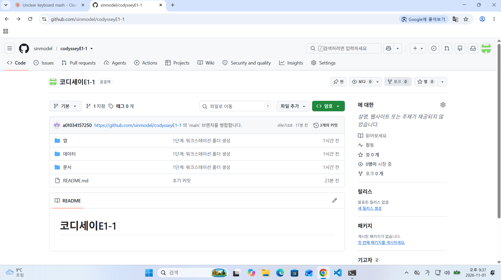 

## 10. 문제점 해결 (trouble shooting)

### Docker CLI에서 Docker daemon 연결 실패

- **문제:** PowerShell에서 `docker version`을 실행했을 때 Docker Desktop Linux Engine named pipe에 연결할 수 없었습니다.
- **원인 가설:** Docker Desktop 엔진이 아직 시작되지 않았거나 WSL2 통합이 준비되지 않았습니다.
- **확인:** Ubuntu WSL에서 `docker version` 및 `docker info`를 다시 실행해 Client뿐 아니라 Server/Engine 버전이 응답하는지 확인하였습니다.
- **해결:** Docker Desktop을 시작하고 WSL2 Ubuntu 연동 상태에서 명령을 실행하였습니다. 이후 Docker Engine 29.9.2 응답과 컨테이너 실행을 확인하였습니다.

### Git push의 인증 및 원격 이력 충돌

- **문제:** 초기 HTTPS push에서 인증이 거부됐고, 이후 원격 README 때문에 로컬 브랜치 push가 non-fast-forward로 거부되었습니다.
- **원인 가설:** HTTPS에서 계정 비밀번호 인증은 지원되지 않으며, 원격 저장소에 로컬과 별도로 생성된 커밋이 있었습니다.
- **확인:** `git remote -v`로 원격 주소를 확인하고, push 거부 메시지에서 원격 이력이 앞서 있음을 확인하였습니다.
- **해결:** 올바른 GitHub 인증 방식으로 로그인한 뒤 `git pull origin main --allow-unrelated-histories --no-rebase`로 이력을 합치고 push하였습니다.   
(토큰이나 비밀번호는 문서에 저장하지 않았습니다.)

## 11. 핵심 개념 요약

- **이미지(image)와 컨테이너(container):**   
이미지는 실행에 필요한 파일과 설정의 template 자료물 이고,  
컨테이너는 그 이미지로 만든 격리된 실행 instance 결과물 입니다.  

- **포트 매핑 (port mapping):**  
`-p 8080:80`은 호스트의 8080번 요청을 컨테이너의 80번 웹 서버로 연결합니다.  

- **바인드 마운트(bind moun)와 볼륨(named volume):**  
바인드 마운트는 호스트의 특정 경로를 연결해 호스트 변경을 바로 반영합니다.   
볼륨은 Docker가 관리하는 저장 공간으로  
컨테이너를 삭제해도 분리되어 데이터를 보존합니다.  

- **권한( File Permissions):**  
`755`는 소유자에게는 읽기, 쓰기, 실행을 허용하고 다른 사용자에게는 읽기, 실행을 허용합니다.  
`644`는 소유자에게 읽기, 쓰기를 허용하고 다른 사용자에게 읽기만 허용합니다.  

------------------------------------------------------------------------------------
